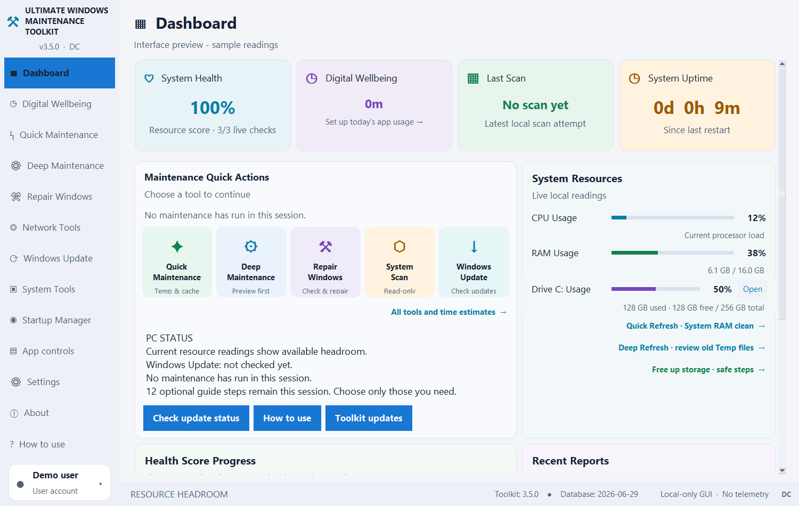

<div align="center">

# Ultimate Windows Maintenance Toolkit

**PC insights and maintenance, in one place.**

Monitor system resources, review maintenance options, and manage optional local features from one Windows desktop app.

**Version 2.5.2 · Preview · Built by DC**

[⬇️ Download UWT 2.5.2 for Windows](https://github.com/DeepC-Toolkit/ultimate-windows-maintenance-toolkit/releases/tag/v2.5.2)

Windows 10 and Windows 11 · Intel/AMD 64-bit PCs  
Free for personal, non-commercial use

[Release notes](https://github.com/DeepC-Toolkit/ultimate-windows-maintenance-toolkit/releases/tag/v2.5.2) · [Get help](https://github.com/DeepC-Toolkit/ultimate-windows-maintenance-toolkit/issues) · [User guide](docs/USER_GUIDE.txt)

</div>

---

## Download and install

1. Open the [UWT 2.5.2 release page](https://github.com/DeepC-Toolkit/ultimate-windows-maintenance-toolkit/releases/tag/v2.5.2).
2. Under **Assets**, download `UltimateWindowsMaintenanceToolkit-2.5.2-Setup.exe`. The `.sha256` file beside it is for checking the download; the automatically listed **Source code** archives are not Windows installers.
3. In PowerShell, calculate the downloaded installer’s SHA-256:

   ```powershell
   Get-FileHash -Algorithm SHA256 -LiteralPath "$env:USERPROFILE\Downloads\UltimateWindowsMaintenanceToolkit-2.5.2-Setup.exe"
   ```

4. Compare the displayed hash with the `.sha256` asset on the release page. If they do not match, do not open the installer.
5. Close Toolkit from its system-tray menu before installing. Open Setup, review the Windows permission prompt, and follow the installer.
6. Launch Toolkit and review **Settings** for startup, Digital Wellbeing, notifications, and Gaming Mode preferences.

### Updating from 3.5.1

Version 2.5.2 begins a new version-numbering sequence. The 3.5.1 updater may not offer this lower-numbered version, so existing users need to install 2.5.2 manually from the release page. If you want to upgrade an existing installation, close Toolkit and its tracker first, then use the same installation location. Future releases are planned for the 2.5.3 sequence.

### Preview status

This installer is unsigned, so Windows or a browser may show an unknown-publisher or download warning. The checksum can confirm that a file matches the published hash; it does **not** prove who published it or certify that it is safe. Broader clean-PC, upgrade, uninstall, and compatibility testing is still pending. 32-bit Windows is not supported; ARM64 compatibility has not been verified.

---

## Take a look

> These are historical **3.5.0** interface previews. The 2.5.2 interface may differ. The screenshots use sample readings; the resource score is not a security scan.



*Historical 3.5.0 light-theme preview with sample readings.*
