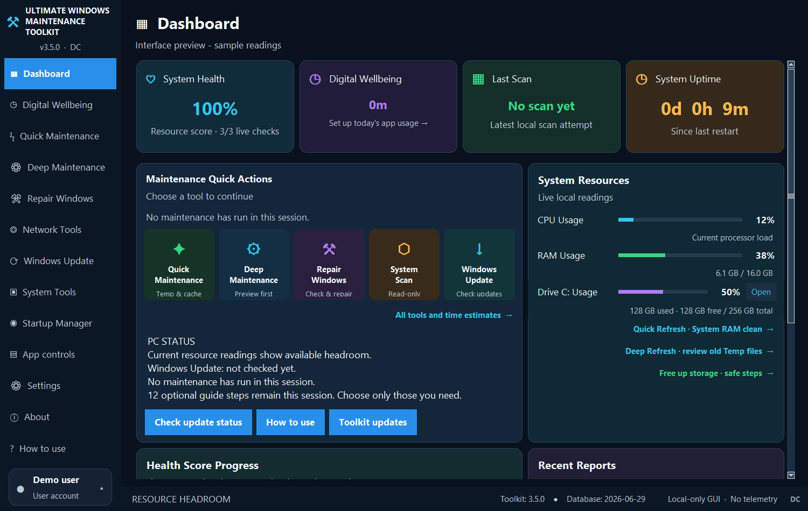

# Ultimate Windows Maintenance Toolkit

**PC insights and maintenance, in one place.**

Monitor system resources, manage startup apps, and review maintenance actions from one Windows desktop app.

**Version 3.5.0 · Public Beta · Built by DC**

## [⬇ Download 3.5.0 for Windows](https://github.com/DeepC-Toolkit/ultimate-windows-maintenance-toolkit/releases/download/v3.5.0/UltimateWindowsMaintenanceToolkit-3.5.0-Setup.exe)

Windows 10 and Windows 11 · Intel/AMD 64-bit PCs  
Free for personal, non-commercial use

[Release notes](https://github.com/DeepC-Toolkit/ultimate-windows-maintenance-toolkit/releases/tag/v3.5.0) · [Get help](https://github.com/DeepC-Toolkit/ultimate-windows-maintenance-toolkit/issues) · [User guide](docs/USER_GUIDE.txt)

---

## Download and install

1. **Download** — Click **Download 3.5.0 for Windows** above to get the Setup EXE.
2. **Install** — Open the downloaded file, review the Windows permission request, and follow the setup instructions.
3. **Get started** — Launch Toolkit and open **Settings** to choose your theme, startup preferences, and notifications.

**Already using Toolkit?** Finish any running maintenance and choose **Exit** from the Toolkit tray menu before running the new Setup. Use your existing installation folder to retain settings and history. You can upgrade directly from 3.3.3.2 to 3.5.0; installing 3.4.1 first is not required.

> **Before you install:** this public beta is unsigned, so Windows or Edge may display an unknown-publisher or download warning. Testing on additional PCs is ongoing. ARM64/Snapdragon compatibility is not verified; 32-bit Windows is not supported.

<strong>Which file should I download?</strong>

| File | Purpose |
| --- | --- |
| **UltimateWindowsMaintenanceToolkit-3.5.0-Setup.exe** | The installer for both new installations and upgrades |
| **Setup.exe.sha256** | An optional checksum file for checking the downloaded installer |
| **Source code (zip / tar.gz)** | An archive of this repository, not the Windows installer |

The installer and its checksum are listed under **Assets** on the [release page](https://github.com/DeepC-Toolkit/ultimate-windows-maintenance-toolkit/releases/tag/v3.5.0). A checksum checks file integrity; it does not verify the publisher's identity.

## Take a look

*Interface preview with sample readings. The resource score reflects available system resources, not a security scan.*

<strong>View the dark theme</strong>

## What you can do

| Feature | How it helps |
| --- | --- |
| **Dashboard** | View CPU, RAM, supported GPU readings, and drive usage |
| **Quick Refresh** | Request RAM cleanup, followed by cleanup of old temporary files for your Windows account |
| **Deep Refresh** | Preview and clean old temporary files for your Windows account while keeping apps open |
| **Startup and app controls** | Manage startup entries, pause or resume supported apps, and choose CPU/GPU preferences |
| **Maintenance tools** | Review cleanup actions and use Windows diagnostic, repair, and update tools |
| **Digital Wellbeing** | View optional app-usage history stored on your PC |
| **Local reports** | Review maintenance results saved on your PC |

Review each maintenance action before running it, and keep backups of important files. Some actions require administrator permission.

<strong>Understand Quick Refresh and Deep Refresh</strong>

**Quick Refresh** requests system RAM cleanup and then cleans old temporary files for your account. Apps may briefly pause while Windows reloads memory pages. Lower RAM usage does not necessarily mean better performance.

**Deep Refresh** previews a limited set of temporary files older than seven days for your account. You review the results before confirming cleanup. It does not close apps or clear Windows Prefetch.

Neither feature guarantees a speed increase. Optional service discovery is not a malware scan.

## New in 3.5.0

- **Clearer update windows** — Long release notes scroll while download and install buttons remain visible.
- **Deep Refresh** — Review old temporary files before removing them.
- **More responsive navigation** — Improved searches and a fixed sidebar without scrolling.
- **Account shortcuts** — Open preferences, reports, Windows account settings, updates, and feedback from your account card.
- **Flexible reminders** — Choose 5, 15, 30, 45, or 60 minutes. The default is 30 minutes, and existing notification opt-outs are preserved.

[Read the changelog](CHANGELOG.md)

## Keep Toolkit up to date

Open **About → Toolkit updates → Check again** to check manually.

In version 3.5.0, automatic checking looks for official GitHub releases when the app opens and every six hours while it is running, including public betas. This requires internet access and automatic checking to be enabled. **You choose when to download and install.**

<strong>Updating an older version or having trouble?</strong>

- **The old update window hides its buttons:** use the download link at the top of this page.
- **The update service is not connected:** download the Setup from the [release page](https://github.com/DeepC-Toolkit/ultimate-windows-maintenance-toolkit/releases/tag/v3.5.0).
- **The background tracker is still running:** use **Pause Toolkit for update** from the Windows Start menu before setup, if that shortcut is available in your installation.
- **An update is available, but About still shows the old version:** finish installing the new Setup and reopen Toolkit. A notification alone does not install the update.
- **GitHub's sidebar shows an older “Latest” release:** 3.5.0 is a public beta. Use this page's download link for this version.

## Help and feedback

**[Report a problem or suggest a feature](https://github.com/DeepC-Toolkit/ultimate-windows-maintenance-toolkit/issues)**

Include your Toolkit version, Windows version, what you expected, and what happened. GitHub requires an account to submit a report. Reports and replies are public, so remove personal information from screenshots and descriptions.

You can also use **About → Feedback / report a problem** in version 3.5.0 to prepare a draft and open GitHub Issues. Review and submit it yourself; nothing is posted automatically. [More support options](SUPPORT.md).

## Privacy

Settings, reports, and optional Digital Wellbeing history stay on your PC. Digital Wellbeing records app names and usage durations, not keystrokes, screenshots, window titles, or website addresses.

<strong>Preferences and network connections</strong>

Fresh installations enable startup and Digital Wellbeing. You can change both in Settings, and saved opt-outs are preserved during upgrades. High-load reminders appear only after two minutes of sustained very high CPU or RAM use; the selected interval controls repeat reminders.

Update checks contact GitHub without uploading reports or usage history. Windows Update and requested network diagnostics may contact their respective services. Hosting services can see ordinary connection information, including your public IP address.

[Read the privacy details](docs/PRIVACY.md).

## License

Free for personal, non-commercial use under the [DC Proprietary Software License](LICENSE). Share the official release link with others. Read the license for permissions, restrictions, and exceptions.

This repository provides official downloads, documentation, and support. The original Toolkit application's source code is private. Third-party components retain their own licenses and rights.

[Third-party notices](THIRD_PARTY_NOTICES.txt) · [Third-party licenses](third_party_licenses/) · [Library source and replacement information](THIRD_PARTY_REPLACEMENT.txt)

---

[Download 3.5.0](https://github.com/DeepC-Toolkit/ultimate-windows-maintenance-toolkit/releases/download/v3.5.0/UltimateWindowsMaintenanceToolkit-3.5.0-Setup.exe) · [All releases](https://github.com/DeepC-Toolkit/ultimate-windows-maintenance-toolkit/releases) · [Support](SUPPORT.md)

© 2026 DC
